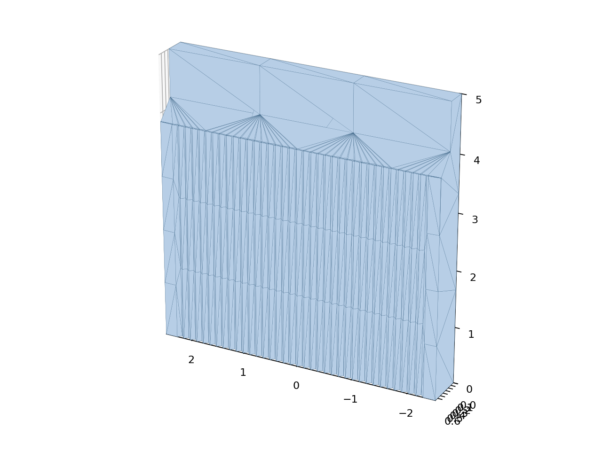
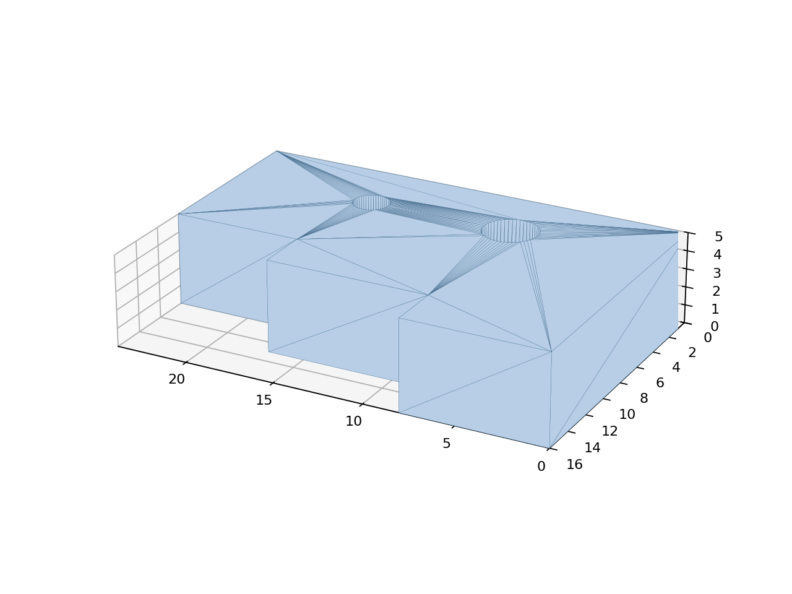
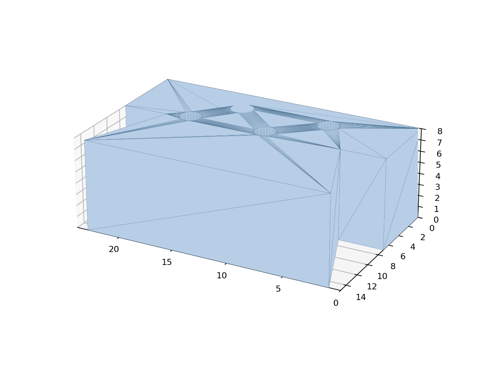
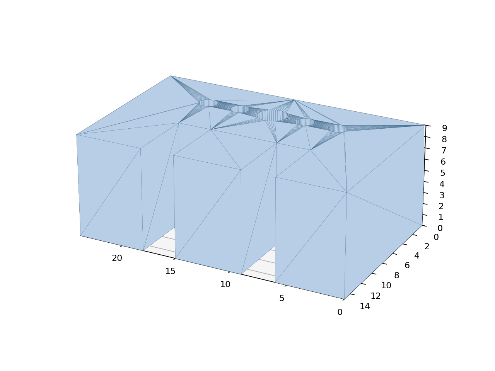

# PDF to Zemax modeling agent

该项目从机械工程 PDF 生成可在 Ansys Zemax OpticStudio 中打开的非序列模型。LangGraph 编排读图、构建、验收和返修。模型通过 Responses API 生成声明式几何方案，并审核从重开的模型取得的证据。MCP 提供局部图纸读取、规格校验、建模、测量和出图。通用适配器通过 ZOSAPI 执行实际建模操作。

## 建模成果

下图来自此前建模运行的 `native_views/axonometric.png`，由重开的 Zemax 模型生成。

| V 形槽 | 双台阶 |
| --- | --- |
|  |  |

| 燕尾槽 | 双槽 |
| --- | --- |
|  |  |

## Windows 环境

- 安装 Windows 版 OpticStudio，并确认许可证支持 ZOS-API Standalone。已验证的版本是 OpticStudio 2023 R1。
- 安装 64 位 Python 3.11。请在可以正常启动 OpticStudio 的 Windows 用户下运行。
- 准备一个支持 Responses API、图像输入和函数调用的模型服务及 API 密钥。原评测使用 gpt-6-sol。模型名称取决于服务可用的部署。

在 PowerShell 中执行以下命令。将 OpticStudio 安装路径改成包含 ZOSAPI_NetHelper.dll、ZOSAPI_Interfaces.dll 和 ZOSAPI.dll 的目录。

~~~powershell
git clone https://github.com/YuZhongFanXing/Zemax.git
Set-Location Zemax
py -3.11 -m venv .venv
.\.venv\Scripts\python.exe -m pip install -r requirements.txt
$env:OPTICSTUDIO_INSTALL = 'C:\Program Files\Ansys Zemax OpticStudio'
$env:ZEMAX_GATEWAY_URL = 'https://api.openai.com/v1'
$env:ZEMAX_GATEWAY_MODEL = Read-Host 'Responses API model or deployment name'
$env:ZEMAX_GATEWAY_KEY = Read-Host 'API key' -MaskInput
.\.venv\Scripts\python.exe -m unittest agent_langgraph.test_agent_langgraph
~~~

模型服务地址填写 API 根路径，程序会追加 /responses。环境变量只对当前 PowerShell 和其子进程生效。

## 生成示例并运行一题

~~~powershell
.\.venv\Scripts\python.exe benchmarks/pdf_modeling/benchmark.py out/demo --generate-only
.\.venv\Scripts\python.exe -m agent_langgraph.runner --responses --pdf out/demo/drawings/step_block.pdf --workspace out/step_block --max-attempts 3 --max-minutes 20
~~~

每次运行使用新的或空的工作区。换成自己的 PDF 时，替换 --pdf 和 --workspace。成功退出码为 0，最终结果位于工作区的 final 目录。

| 文件 | 内容 |
|---|---|
| final/model.zos | OpticStudio 原生模型 |
| final/apertures/ | 拉伸对象依赖的 UDA 轮廓副本 |
| final/geometry_spec.json | 模型生成的建模方案 |
| final/verification.json | 重开、几何和视图验收，含推断与假设 |
| final/native_geometry_evidence.json | 外形尺寸、截面、可用体积和视图哈希 |
| final/native_views/ | 正投影、剖面和等轴视图 |
| attempts/ | 每次构建的日志和中间产物 |
| audit/ | 模型请求、回复和流水线记录 |

在另一台机器打开模型时，请把 final/apertures 中的 UDA 文件复制到该用户的 Zemax Objects/Apertures 目录，再打开 model.zos。构建机已自动安装当次所用的 UDA。

## 示例流程：从台阶块 PDF 到交付

上面的命令生成 `step_block.pdf` 并启动一次 LangGraph 运行。图纸给出总长 12 mm、左段长 7 mm 且高 5 mm、右段长 5 mm 且高 3 mm，以及 6 mm 的拉伸深度。

1. **预检与读图（`preflight` → `prepare_inputs`）**。Agent 检查运行环境，将当前 PDF 放入任务工作区，读取文本和页面图像。GPT 可以经由 MCP 查看局部标注，将外形、尺寸和假设写入声明式几何方案。
2. **定方案（`select_strategy` → `prepare_request`）**。GPT 给出建模候选。以台阶块为例，可用六个顶点定义台阶截面，再沿深度方向拉伸 6 mm。LangGraph 将候选方案和本次构建请求传给固定脚本。
3. **构建和取证（`execute_pipeline`）**。通用适配器调用 ZOSAPI 创建非序列对象，保存 `.zos`，关闭后通过新实例重开，从重开的模型读取参数并采集尺寸、截面和视图。几何和视图是必查项，STEP/STL 导出按需执行。
4. **审核和返修（`visual_gate` → `inspect_gates`）**。GPT 审核图纸与模型证据。例如检查外形是否为 12 × 5 × 6 mm，并在侧视或截面中检查两级高度和台阶位置。若右段被误做成 5 mm 高，验收失败后 LangGraph 将反馈交给 `repair`，在预算内尝试下一候选或修订方案并重新构建。
5. **交付（`finalize`）**。通过后在 `final/` 提供可打开的 `model.zos`、依赖轮廓、几何证据、视图和验收报告。尝试用尽后保留日志和失败原因，运行以非零退出码结束。

[LangGraph 状态图实现](agent_langgraph/graph.py)

## 批量评测

~~~powershell
# 基础题库，共 3 题
.\.venv\Scripts\python.exe benchmarks/pdf_modeling/benchmark.py out/basic

# 十类截面和通孔布局，共 50 题
.\.venv\Scripts\python.exe benchmarks/pdf_modeling/benchmark.py out/extended --extended

# 中断后继续未完成的题目
.\.venv\Scripts\python.exe benchmarks/pdf_modeling/benchmark.py out/extended --resume
~~~

生成器把参考值写入 reference.json。每题的建模进程接收当次 PDF，评分器随后核对外形尺寸、体积、孔数和孔径。结果逐题写入 results.json。若想用新设置重跑所有题，使用新的输出目录。历史 50 题复测在一次连接中断补跑后通过 49 题，覆盖的是恒定截面和圆柱通孔组合。

## 工作流与故障定位

1. GPT 读取 PDF 文本和页面图像，并可通过 MCP 放大当前页局部。方案支持盒体、圆柱、轮廓拉伸、圆孔和布尔组合。
2. LangGraph 校验方案后调用固定适配器，构建并保存 .zos，随后用新实例重开并回读。
3. 几何和视图从模型取证。如果原生显示网格不能提供有效体积，流程可用同一模型导出的经哈希校验的 STL。STEP/STL 导出可选。
4. GPT 审核图纸与证据。若未通过，LangGraph 按预算尝试下一候选或把失败反馈交给模型修订。含估算的通过结果在验收报告中标记为 approximate。

启动失败时检查 attempts 中的 agent.log。找不到 DLL 时核对 OPTICSTUDIO_INSTALL。无法创建 ZOSAPI 实例时，先用相同 Windows 用户打开 OpticStudio 核对许可证。遇到 API 401、404、429 或超时时，检查密钥、服务路径、模型部署及限流。可以用 ZEMAX_GATEWAY_TIMEOUT_SECONDS 调整单次网络请求时限。报告与审计记录包含当次图纸及模型数据，发布评测产物前请确认可公开。
